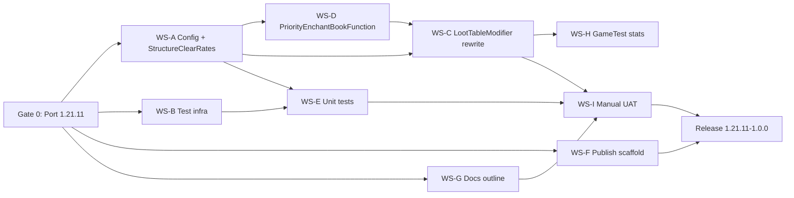

# Implementation Roadmap — structure_loot_rebalance v1

**Target:** Minecraft **1.21.11** · first release **`1.21.11-1.0.0`**  
**Design authority:** [`single-slot-priority-roll.md`](single-slot-priority-roll.md)  
**Epic:** [Tool enchant structure loot (stacked tiers)](https://app.notion.com/p/3c416e8d4da381c3b526e51217a1fec9)

---

## Locked design summary

| Item | Decision |
|------|----------|
| Roll model | **Single-slot priority partition** — one roll per chest: Mending → Fortune → base |
| Structure-clear rates | Mending **12%**, Fortune **24%**, Base **48%** (each 2× previous) |
| Per-chest math | `a = 1−0.88^(1/n)`, `b = 1−0.76^(1/n)`, `c = 1−0.52^(1/n)` |
| Vanilla books | **Strip** enchanted books on modified tables |
| Book builder | **`SetEnchantmentsFunction`**, Level I only |
| Trial Mending | **`trial_chambers/reward` only** — not supply/corridor |
| Ominous vaults | **`trial_chambers/reward_ominous` excluded** (v1) |
| Old code | **Dead** — discard 1.21.10 WIP; rewrite clean |
| Config v2 | `tier`, `structure_id`, `structure_loot_events`, `mending_enabled`, `base_weights`, optional `rate_multiplier` |

---

## Current repo state

| Area | Status |
|------|--------|
| Branch | `1.21.10` with uncommitted Mending-only WIP — **discard** |
| Runtime | Multi-pool `add[]` + old defaults — **replace** |
| Tests | No JUnit source set |
| Publish | No `publish.yml` |
| Docs | README / checklist describe old model |

---

## Critical path



**Serial bottleneck:** Gate 0 → WS-A + WS-D → WS-C → UAT → ship.  
**Everything else can overlap** once Gate 0 lands.

---

## Wave 0 — Gate (blocks all code)

**Owner:** one session · **~0.5–1 day**

| Step | Deliverable | Notion task |
|------|-------------|-------------|
| 0.1 | Fresh branch `1.21.11`; bump Loom / Fabric API / MC version | [Port to 1.21.11](https://app.notion.com/p/3c616e8d4da38137a74ff7ac122570fc) |
| 0.2 | Revert/discard uncommitted 1.21.10 WIP | (same) |
| 0.3 | `./gradlew build` green on 1.21.11 | (same) |
| 0.4 | Push branch; set as working default | (same) |

**Parallel during Gate 0:** none — everything waits on the port.

---

## Wave 1 — Parallel foundation (after Gate 0)

Four independent tracks. **Start all four the same day Gate 0 merges.**

### WS-A — Config v2 + StructureClearRates + tier registry (P0)

**Notion:** [Implement stacked tier defaults](https://app.notion.com/p/3c616e8d4da381f7a2f4dc1d41def396)

| Deliverable | Notes |
|-------------|-------|
| `StructureClearRates` | Pure math: given `n`, tier, `mending_enabled` → `a`, `b`, `c` |
| `StructureTierRegistry` | Full tier map; per-structure `n`; trial reward-only Mending |
| Config v2 schema + Gson | Replace `add[]` / `remove[]` defaults |
| `DefaultLootModifications` | Generate defaults from registry |
| **Exclude** | `end_city_*`, all village except `village_temple`, **`reward_ominous`** |

**Blocks:** WS-D, WS-C, most of WS-E.

---

### WS-B — JUnit test infrastructure (P1)

**Notion:** [Add Fabric Loader JUnit test infrastructure](https://app.notion.com/p/3c616e8d4da381d983f9e09f763e3458)

| Deliverable | Notes |
|-------------|-------|
| `fabricApi { configureTests }` in `build.gradle` | Mirror `mob_combat_rebalance` |
| `src/test/java/` scaffold | Empty green test |
| CI | `./gradlew build` runs unit tests |

**Blocks:** WS-E only. **No dependency on WS-A.**

---

### WS-F — Publish scaffold (P2)

**Notion:** [Wire publish.yml and Modrinth](https://app.notion.com/p/3c616e8d4da38169aaa7f5fd6f6cb9b0)

| Deliverable | Notes |
|-------------|-------|
| `publish.yml` | Copy from wired mod template |
| `releases/TEMPLATE.md` | Changelog skeleton |
| README Releases section | Placeholder until ship |

**Fully parallel** — needed only at release.

---

### WS-G — Docs outline (P2)

**Notion:** [Update README and UAT checklist](https://app.notion.com/p/3c616e8d4da3819b90d5fc0bb7f8c1ca)

| Deliverable | Notes |
|-------------|-------|
| README skeleton | Single-slot model, tier map, End excluded, ominous excluded |
| `plan/testing-checklist.md` outline | AC-1–4 command cheat sheet |
| Link to `single-slot-priority-roll.md` | |

**Finalize after WS-C lands**; outline can start immediately.

---

## Wave 2 — Core runtime (after WS-A contract is defined)

Two tracks that can **partially overlap**:

### WS-D — PriorityEnchantBookFunction (P0)

**Notion:** [Implement PriorityEnchantBookFunction](https://app.notion.com/p/3c616e8d4da3819fbb7cf56b385319e8)

| Deliverable | Notes |
|-------------|-------|
| Custom loot function | Partition roll `u`; tier gates; base weight pick |
| `SetEnchantmentsFunction` | Fixed Level I books |
| Register in `fabric.mod.json` / data | |
| Unit tests | Cascade logic, trial supply no Mending, tier 1/2/3 gates |

**Starts after:** WS-A defines config shape + `StructureClearRates` API (can stub registry while WS-A finishes).

**Parallel with:** WS-B continuing, WS-E sub-stream E1 (config round-trip once schema exists).

---

### WS-C — LootTableModifier rewrite (P0)

**Notion:** [Runtime rewrite: SetEnchantments + strip vanilla books](https://app.notion.com/p/3c616e8d4da381898fa8c311e6043a79)

| Deliverable | Notes |
|-------------|-------|
| One pool per modified table | Single entry → `PriorityEnchantBookFunction` |
| `MODIFY_DROPS` strip | Remove vanilla enchanted books |
| Remove dead paths | `add[]` multi-pool, `remove_vanilla_mending`, mod tags |
| Smoke test | `/loot give` per tier |

**Starts after:** WS-D function exists (or in parallel with WS-D if function interface agreed early).

---

## Wave 2 — Core runtime ✅

- **WS-D** — `PriorityEnchantBookFunction`, `PriorityEnchantBookRoll`, `ModEnchantedBooks`
- **WS-C** — `LootTableModifier` one-pool injection + `MODIFY_DROPS` vanilla book strip

## Wave 3 — Tests (parallel sub-streams)

### WS-E — Unit tests (7 Notion tasks under epic)

**Can start in parallel once dependencies met:**

| Sub-stream | Can start after | Coverage |
|------------|-----------------|----------|
| **E1** Config v2 round-trip | WS-B (+ WS-A schema draft) | Gson parse/serialize |
| **E2** StructureClearRates math | WS-B only | `a/b/c` for n=7,12; Monte Carlo structure-clear |
| **E3** Tier 1 gates | WS-A | Base only; no Fortune/Mending |
| **E4** Tier 2 gates | WS-A | Fortune + base; no Mending |
| **E5** Tier 3 + trial split | WS-A | Mending on reward only; supply excluded |
| **E6** End + ominous absent | WS-A | No config entries |
| **E7** User override merge | WS-A + loader | Invalid entry skip |

**E1 + E2** can run **immediately after WS-B** without waiting for runtime.

---

### WS-H — GameTest statistical rolls (P2)

**Notion:** [GameTest: statistical loot roll verification](https://app.notion.com/p/3c616e8d4da38183bdfed68c4c7d04ea)

| Deliverable | Notes |
|-------------|-------|
| Monte Carlo harness | 1000 simulated structure clears per type |
| Assert bands | Mending ±2%, Fortune ±3%, Base ±5% vs 12/24/48% |
| Trial chambers | n counts **reward vaults only** |

**Blocked by:** WS-C + test infra (GameTest source set if not already in WS-B).

**Parallel with:** WS-I prep, WS-G finalize.

---

## Wave 4 — Ship gate

### WS-I — Manual UAT (P1)

**Notion:** [Manual UAT: AC-1 through AC-4](https://app.notion.com/p/3c616e8d4da381dab4edf885b835ec43)

| AC | Validation |
|----|------------|
| AC-1 | Tier 1 — mineshaft/outpost; base only |
| AC-2 | Tier 2 — temple; Fortune + base; no Mending |
| AC-3 | Tier 3 — stronghold, mansion, trial **reward** vaults |
| AC-4 | End city + **ominous vault** unchanged |

**Tune:** `structure_loot_events`, `rate_multiplier` for village_temple / ruined portal.

---

### Release

**Skill:** `fabric-mod-publish` · **`1.21.11-1.0.0`**

Prerequisites: WS-I pass, WS-E green, WS-H green (or waived with documented tolerance), WS-F merged.

---

## Parallelization matrix

| Track | Wave | Parallel with | Blocked by |
|-------|------|---------------|------------|
| Gate 0 Port | 0 | — | — |
| WS-A Config/registry | 1 | WS-B, WS-F, WS-G | Gate 0 |
| WS-B Test infra | 1 | WS-A, WS-F, WS-G | Gate 0 |
| WS-F Publish | 1 | all Wave 1 | Gate 0 |
| WS-G Docs outline | 1 | all Wave 1 | Gate 0 |
| WS-D Loot function | 2 | WS-E E1/E2 | WS-A API |
| WS-C Modifier rewrite | 2 | WS-E | WS-A + WS-D |
| WS-E Unit tests | 3 | WS-H (late) | WS-B; per-stream WS-A |
| WS-H GameTest stats | 3 | WS-G finalize | WS-C |
| WS-I Manual UAT | 4 | — | WS-C (+ WS-G checklist) |

---

## Two-developer split (recommended)

| Developer A (runtime) | Developer B (infra + quality) |
|-----------------------|-------------------------------|
| Gate 0 → WS-A | Gate 0 → WS-B + WS-F |
| WS-D → WS-C | WS-E (E1/E2 first, then E3–E7) |
| WS-I execution | WS-G + WS-H |
| Release cut | Publish pipeline verify |

**Contract handoff:** WS-A publishes `StructureClearRates` + config v2 types → unblocks B's E2 and A's WS-D.

---

## Branch strategy

```
1.21.11                          ← Gate 0 (merge first)
1.21.11/test-infra               ← WS-B (+ early WS-E E1/E2)
1.21.11/config-v2                ← WS-A
1.21.11/priority-loot-function   ← WS-D
1.21.11/loot-modifier-rewrite    ← WS-C (depends on config + function)
1.21.11/docs-publish             ← WS-F + WS-G
```

Merge order: `test-infra` → `config-v2` → `priority-loot-function` → `loot-modifier-rewrite` → `docs-publish` → UAT on `1.21.11`.

---

## Risk register

| Risk | Mitigation |
|------|------------|
| Custom loot function API changed in 1.21.11 | Spike in Gate 0: register stub function before bulk defaults |
| Trial `n` wrong (ominous counted) | Document n = regular reward vaults only; unit test registry |
| Structure-clear rates drift | E2 Monte Carlo + WS-H GameTest gate |
| Old WIP confuses merge | Hard reset on fresh 1.21.11 branch in Gate 0 |
| Village_temple / ruined portal too generous | `rate_multiplier` tunable in config; UAT |

---

## Deferred (post-v1)

- `trial_chambers/reward_ominous` — same rules as reward vaults or separate rate
- Generic `remove[]` config for power users
- Trail ruins tier confirmation (if not already in registry)
- Odds calculator HTML (optional)

---

## Execution checklist (single developer)

1. **Day 1 AM:** Gate 0 — port, discard WIP, green build
2. **Day 1 PM:** WS-B + WS-F + WS-G outline **in parallel**; start WS-A
3. **Day 2:** WS-A complete → WS-D → WS-C
4. **Day 2–3:** WS-E (E2 first for rate confidence, then tier gates)
5. **Day 3:** WS-H GameTest + WS-G finalize
6. **Day 4:** WS-I UAT → tune n / multipliers → ship
