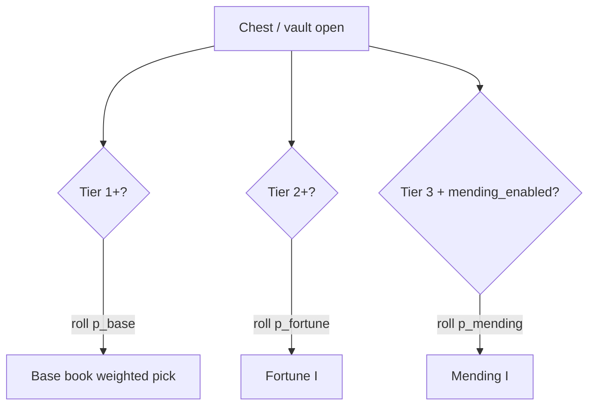

# Multi-Pool Structure-Clear Model

**Status:** Locked (Option B — expected-count targets)

**Supersedes:** at-least-one targets (60/40/50% for base/fortune/mending) from the first multi-pool revision.

## Overview

**Independent roll per branch per chest** — tiers stack as separate loot pools, not a single priority slot.

Structure expectations apply per **full structure clear** (using that structure's `n` loot events). Trial chambers: Mending uses **regular reward vault opens only**; supply/corridor roll base + Fortune without Mending. **`trial_chambers/reward_ominous` excluded** (v1).

Nothing is guaranteed — variance is intentional. Targets describe **typical** hauls, not floors or ceilings.

## Structure-clear expectations (locked)

### Tier 3 (e.g. trial chambers, stronghold)

| Branch | Target | Meaning |
|--------|--------|---------|
| **Base (T1)** | **~2.5 books / clear** | Midpoint of “1–4”; scales with `n` |
| **Fortune (T2)** | **~1.5 books / clear** | Midpoint of “1–2” |
| **Mending (T3)** | **~50% of clears** | P(at least one Mending book) |

### Tier 2

| Branch | Target |
|--------|--------|
| **Base** | **~2.0 books / clear** |
| **Fortune** | **~1.0 books / clear** |

### Tier 1

| Branch | Target |
|--------|--------|
| **Base** | **~2.5 books / clear** |

Tier 1 rare (`village_temple`, ruined portal): same branches with reduced `rate_multiplier` (UAT).

## Per-chest formulas

**Base and Fortune** (expected count):

```
p = min(0.9999, expected / n)
```

Expected books over a full clear ≈ `n × p = expected`.

**Mending** (at least one per clear):

```
p = 1 − (1 − 0.50)^(1/n)
```

Within the **base** branch only, pick Efficiency / Unbreaking / Protection / Feather Falling (Tier 1) by `base_weights`. Silk Touch is excluded (villager trade exclusive).

Optional **`theme_weights` + `theme_rate`** add an independent theme pool (underwater, ancient city, nether). Theme-exclusive enchants are blocked from villager librarians.

## Example per-chest rates

| Structure | n | Base | Fortune | Mending |
|-----------|---|------|---------|---------|
| Mineshaft (T1) | 6 | **42%** | — | — |
| Desert pyramid (T2) | 4 | 50% | 25% | — |
| Stronghold (T3) | 7 | 36% | 21% | 9% |
| Trial reward vault (T3) | 12 | **21%** | **13%** | 6% |
| Trial supply (T3) | 20 | 13% | 8% | — |

## Roll flow



Each branch is an **independent** pool (item vs empty). A single chest can yield **multiple** mod books.

## Config v2 (unchanged fields)

Per loot table: `tier`, `structure_id`, `structure_loot_events`, `mending_enabled`, `base_weights`, optional `rate_multiplier`, optional `theme_weights` + `theme_rate`.

Global constants in `StructureClearRates`:

```java
TIER1_BASE_EXPECTED   = 2.5
TIER2_BASE_EXPECTED   = 2.0
TIER3_BASE_EXPECTED   = 2.5
TIER2_FORTUNE_EXPECTED = 1.0
TIER3_FORTUNE_EXPECTED = 1.5
TIER3_MENDING_CLEAR   = 0.50   // at least one
```

## Runtime

1. **`StructureClearRates`** — per-branch `p` from tier + `n` + `mending_enabled`.
2. **`LootTableModifier`** — up to three pools per table (base / fortune / mending); strip vanilla enchanted books.
3. **`FixedEnchantBookFunction`** — Level I only, mod-tagged books.
4. Trial **`reward_rare`** override removes vanilla random enchant books.
5. **`VanillaEnchantedGearRateLimiter`** — 50% strip of enchanted player armor and tools on ancient city, bastion (treasure/other/bridge), and trial vault `reward_rare`.
6. **`SilkTouchLootFilter`** — strips Silk Touch from all mod-target loot tables.
7. **Theme pools** — Respiration/Depth Strider (underwater), Swift Sneak (ancient city), Soul Speed (nether).

## Tests

- Unit: `StructureClearRates` per-tier examples above.
- Monte Carlo: mean base/fortune counts ≈ 2.5 / 1.5 over Tier 3 clears; Mending ≈ 50% at-least-one.
- GameTest / UAT: per structure type.
