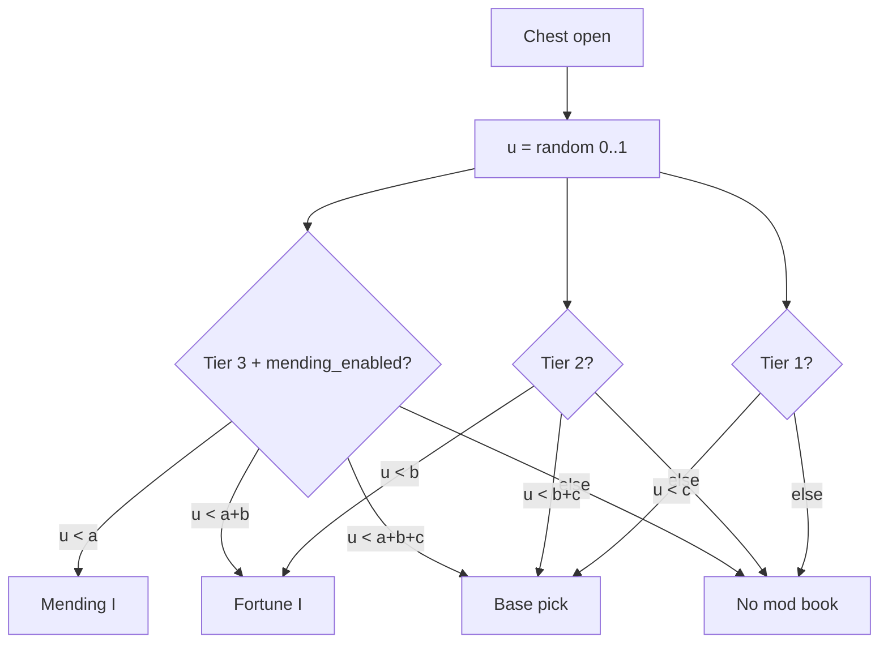

# Single-Slot Priority Roll Model

Design decision (locked): **one mod enchant book roll per chest**, using a **priority partition** so higher tiers are not diluted by lower-tier volume.

**Implementation roadmap:** [`implementation-roadmap.md`](implementation-roadmap.md)

## Structure-clear rate targets (locked)

Per **full structure clear**, P(at least one book of type):

| Branch | Target | Ratio |
|--------|--------|-------|
| **Mending** | **12%** | 1× |
| **Fortune** | **24%** | 2× Mending |
| **Base** (Efficiency / Unbreaking / Silk Touch) | **48%** | 2× Fortune (4× Mending) |

These apply to the **structure type** (using that structure's `n` = loot events per clear). Trial chambers: Mending/Fortune structure rates use **regular reward vault loot events only** (`trial_chambers/reward`); supply/corridor chests use Tier 3 base+Fortune without Mending. **`trial_chambers/reward_ominous` is excluded** (vanilla only) for v1.

## Per-chest probabilities (derived from n)

For a structure with **n** loot-table rolls per clear, compute per-chest rates:

```
a = 1 − 0.88^(1/n)    // Mending  (12% structure clear)
b = 1 − 0.76^(1/n)    // Fortune  (24% structure clear)
c = 1 − 0.52^(1/n)    // Base     (48% structure clear)
```

Proof: `1 − (1 − a)^n = 1 − 0.88 = 0.12` (and similarly for b, c).

**Single roll per chest** (priority partition, tier 3):

```
u ← random [0, 1)
if u < a           → Mending I
else if u < a + b  → Fortune I
else if u < a + b + c → Base (weighted among Efficiency / Unbreaking / Silk Touch)
else               → no mod book
```

**Tier 2** (no Mending branch):

```
if u < b           → Fortune I
else if u < b + c  → Base
else               → no mod book
```

**Tier 1** (base only):

```
if u < c           → Base
else               → no mod book
```

**Tier 1 rare** (`village_temple`, ruined portal): same formulas with reduced `n` or a `rate_multiplier` (UAT).

### Example per-chest rates (Tier 3, stronghold n=7)

| Branch | Per-chest rate | Any mod book |
|--------|----------------|--------------|
| Mending a | 1.83% | |
| Fortune b | 3.80% | |
| Base c | 8.87% | |
| **Total** | **14.5%** | a+b+c |

### Example (trial vaults n=12, supply excluded from Mending)

| Branch | Per-chest |
|--------|-----------|
| a | 0.51% |
| b | 1.06% |
| c | 2.48% |
| **Total** | **4.05%** |

## Roll flow



Trial chambers: `mending_enabled: false` on supply/corridor; **true** on `trial_chambers/reward` only. **`trial_chambers/reward_ominous` excluded** — not modified in v1.

## Config schema (v2)

Per loot table:

```json
{
  "minecraft:chests/stronghold_library": {
    "tier": 3,
    "structure_loot_events": 7,
    "structure_id": "stronghold",
    "mending_enabled": true,
    "base_weights": {
      "minecraft:efficiency": 4,
      "minecraft:unbreaking": 3,
      "minecraft:silk_touch": 3
    },
    "rate_multiplier": 1.0
  },
  "minecraft:chests/trial_chambers/supply": {
    "tier": 3,
    "structure_loot_events": 12,
    "structure_id": "trial_chambers",
    "mending_enabled": false,
    "base_weights": { "minecraft:efficiency": 4, "minecraft:unbreaking": 3, "minecraft:silk_touch": 3 }
  }
}
```

- **`structure_loot_events`**: n for this structure type (shared across tables in the same structure).
- **`structure_id`**: groups tables for structure-clear calibration docs / tests.
- **`mending_enabled`**: false on trial supply; true on reward vaults.
- **`base_weights`**: relative pick within base branch only.
- **`rate_multiplier`**: optional scalar on a/b/c (default 1.0; use &lt;1 for village_temple / ruined portal).
- **Removed**: `slot_rate`, `add[]`, per-enchant weights — rates come from formulas above.

Structure-clear targets are **global constants** in code:

```java
MENDING_CLEAR = 0.12   // → 0.88 retention
FORTUNE_CLEAR = 0.24   // → 0.76 retention
BASE_CLEAR    = 0.48   // → 0.52 retention
```

## Runtime implementation

1. **`StructureClearRates`** — computes a, b, c from n and tier.
2. **`PriorityEnchantBookFunction`** — partition roll; `SetEnchantmentsFunction` for Level I.
3. **`LootTableModifier`** — one pool per table (book entry + function); strip vanilla enchanted books via `MODIFY_DROPS`.
4. Old multi-pool / `slot_rate` / remove config: **dead**.

## Tier map (locked)

| Tier | Structures |
|------|------------|
| 1 | Mineshaft, dungeon, pillager outpost |
| 1 rare | `village_temple`, ruined portal (`rate_multiplier` &lt; 1) |
| 2 | Temples, shipwrecks, buried treasure, underwater ruins, nether fortress, ancient city (non–ice box) |
| 3 | Stronghold (all), ice box, mansion, bastions, trial chambers (reward vaults only for Mending) |
| Excluded | End; other village chests; **`trial_chambers/reward_ominous`** |

## Tests

- Unit: `StructureClearRates` — given n=7, assert a≈0.0183, b≈0.0380, c≈0.0887; Monte Carlo structure-clear ≈12/24/48%.
- GameTest: per structure type, 1000 simulated clears → Mending ±2%, Fortune ±3%, Base ±5%.
